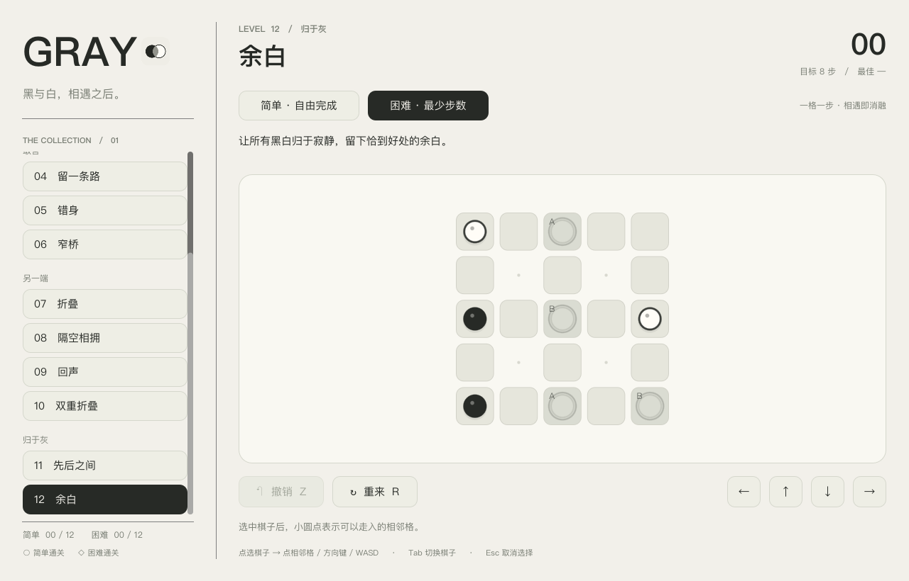

# GRAY

黑与白，相遇之后。

用 **Godot 4 + GDScript** 独立实现的回合制网格解谜游戏。保留 Neutronic 的移动、异色消融、地板消失和传送门规则，采用黑白视觉与原创关卡。暂定中文名「灰」，英文名 **GRAY**。



## 开始游戏

使用 Godot **4.6 或更新的 4.x 版本**导入 `project.godot`，按 **F5** 运行整个项目。当前验证版本为 **4.6.2**。

```bash
godot --path .
```

- 点选棋子，再点相邻格；也可以用方向键或 WASD 移动。
- Tab / Shift Tab 切换棋子，Esc 取消选择。
- Z 撤销，R 重开。无效移动不计步，选择棋子不计步。
- 12 个原创关卡全部开放，每关可切换简单和困难模式。切换模式会重开当前关卡。

## 玩法

每次将一颗棋子向上下左右移动一格。棋子不能走出地板，也不能进入同色棋子所在的格子。黑白相遇时，两颗棋子消失，**相遇位置的地板也消失**；起点地板保留。清空所有棋子即可完成棋盘。

带相同字母的两个传送门相连。进入空传送门后，立即到达另一端，整次行动只算一步。出口同色棋子会阻挡；出口异色棋子会与移动的棋子合并。若入口已有异色棋子，则在入口先合并。传送门上发生合并后，该格消失，另一端变为普通地板。

| 模式 | 通过条件 | 记录 |
| --- | --- | --- |
| 简单 | 清空棋子，步数不限 | ○ 简单通关与个人最佳 |
| 困难 | 清空棋子，步数等于已验证的全局最少步数 | ◇ 困难通关与个人最佳 |

困难模式超步后可以继续探索、撤销或重开；清空棋盘会保留简单通关记录，但不会获得困难标记。简单模式即使走出最优解，也需要切换到困难模式完成一次，才会获得困难标记。撤销会恢复地板、传送门、棋子、选择和步数。

进度保存在 Godot 的 `user://progress.json`，采用独立的简单／困难标记和跨模式个人最佳。没有账号或联网依赖。

## 实现与验证

规则层、会话层、渲染层和存档层分离。关卡保存在 `data/levels.json`；每关附带最优步数、合法解和 BFS 搜索记录。Python 与 GDScript 两套独立求解器会交叉验证最优步数，搜索超限不会生成「最优」结论。

```bash
python3 tools/certify_levels.py
godot --headless --path . --editor --import --quit
godot --headless --path . --script tests/run_tests.gd
godot --path . --script tests/ui_smoke.gd
```

最后一项测试会实际发送鼠标和键盘输入，验证通关、困难超步、动画中撤销及存档，并在 `builds/` 生成 1280×820、960×680 截图。测试使用独立存档，不影响游戏进度。

修改或增加关卡后，运行 `python3 tools/certify_levels.py --write` 重新认证，再运行 Godot 测试。当前关卡最优解为 **1～12 步**，属于首版教学与机制验证内容，后续还需要扩充长线关卡。

## 导出

已配置 macOS 和 Web 预设，需安装与 Godot 版本匹配的导出模板。`data/*.json` 已显式包含在导出资源中。

```bash
mkdir -p builds/macos builds/web
godot --headless --path . --export-release macOS builds/macos/GRAY.zip
godot --headless --path . --export-release Web builds/web/index.html
```

构建产物和 `.godot/` 缓存不进入 Git。仓库保存源码、关卡、测试和设计文档。Web 导出应通过 HTTP 服务打开。

## 设计文档

- [原项目分析和 Godot 实现方案](docs/design.md)
- [关卡编写与最优步数认证](docs/levels.md)

本项目的代码、关卡和矢量资源均独立编写。玩法研究参考 [Neutronic](https://github.com/RayZh-hs/neutronic)，未复制其源码、关卡数据或美术资源。仓库保留原有 MIT License。
