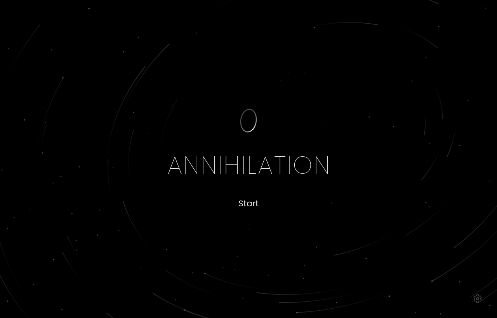

# ANNIHILATION

ANNIHILATION is a minimalist grid puzzle about black and white particles, disappearing paths, and finding the shortest solution. Built with Godot 4 and GDScript.

## Gameplay

Select a particle and move it one tile up, down, left, or right.

- Particles must stay on the remaining tiles.
- Particles of the same color block each other.
- When opposite colors meet, both particles disappear, along with the tile where they meet.
- Clear every particle to finish the level.

Arrow tiles are **one-way fields**. A particle may enter from any side and stop there, but can leave only in the arrow direction. Entering does not cause automatic movement. A collision removes the arrow tile like any other tile.

Linked portals share a letter and color. Entering an empty portal teleports the particle to its partner and costs one move. A same-colored particle at the exit blocks the move. If a collision happens on a portal, that end disappears and its partner becomes a normal tile.

## Modes

| Mode | Goal |
| --- | --- |
| Easy | Clear the board in any number of moves. |
| Hard | Clear the board in the verified minimum number of moves. |

Each campaign level supports both modes, with separate completion records and a shared personal best. Clearing Hard also marks Easy complete. Invalid moves and selection changes do not count. Undo restores particles, tiles, portals, and the move counter.

## Features

- 36 handcrafted levels across eleven chapters. Finish every Easy level in a chapter to unlock the next; levels within an open chapter can be played in any order.
- Advanced chapters after level 20, including dense maps with six portal groups and twelve particles.
- Two later chapters introduce one-way fields, directed loops, waiting points, and portal traffic.
- A level editor with drawing tools, undo/redo, automatic drafts, a personal library, and isolated playtesting.
- Local custom-level leaderboards with personal bests and JSON sharing of maps and completed walks.
- Campaign minimum move counts verified by independent Python and GDScript solvers.
- Automatic saves, resumable games, and undo history restored after restarting.
- A minimal title screen with scalable text and controls. Start opens level selection; Continue in the campaign selection restores the saved run.
- A My levels tab for playing, editing, and viewing the records of saved custom maps.
- Black-and-white pieces, a pure black background with faint star trails, and an orbital zero mark.
- Responsive chapter selection, progress indicators, pause menus, and Settings, with readable controls in fullscreen.
- Soft original piano and organ music with smooth looping, quieter playback during puzzles, and saved music/volume controls under Settings → Audio.
- Reduced-motion controls; background details fade during play.
- English by default, with an instant, saved switch to Simplified Chinese in Settings → General → Language.
- Centered, square-cell boards that resize with the window, without a text footer during play.

## Controls

| Input | Action |
| --- | --- |
| Click a particle, then an adjacent tile | Select and move |
| Arrow keys / WASD | Move the selected particle |
| Tab / Shift+Tab | Cycle through particles |
| Z | Undo |
| R | Restart the level |
| Esc | Deselect, then pause |
| Enter / Space on the title screen | Open level selection |
| F11 | Toggle fullscreen |

Level selection is available from the back button during play or the pause menu. Switching modes restarts the current level.
Optional controls and a short rules reference are available under Settings → Controls.

## Make your own levels

Open **Settings → Developer**, enable **Developer mode**, and choose **Level editor**.
Developer mode unlocks every campaign level and reveals **Create** and **Edit** in **My levels**. Turning it off restores normal chapter progression while keeping your genuine completion records and drafts.
Start with a blank map or copy a campaign level, paint tiles and particles, then press **F5** to playtest.
Maps support up to **12 × 12** tiles, portal groups **A–Z**, and four directional field brushes.

Choose **Save** in the editor to add a map to **Start → My levels**. Imported maps also need to be saved to appear there.
Use **Play** or **Leaderboard** beside a saved map, or **Edit** with Developer mode enabled; unfinished maps can be edited until they are ready to play.

Custom levels have no minimum-verification step. Finish a playtest to set a record, then improve it with fewer moves.
Open **Leaderboard** to set your player name and see the best completed run for each name.
Export JSON to share a map and its records; importing a friend’s JSON merges valid completed walks.
Records stay local and do not sync automatically. Save maps to your local library or import/export JSON files. See the [editor guide](docs/editor.md).

## Run locally

Open the project with **Godot 4.6** and press **F5**, or run:

~~~bash
godot --path .
~~~

Tested with Godot **4.6.2**. The game runs locally, with progress and preferences stored on your device.

## Development

Levels live in `data/levels.json`. The rules, session history, rendering, navigation, and persistence are separate modules.
UI copy and level names use English source messages, with translations in `locale/`. Changing language keeps the current puzzle and undo history intact.

~~~bash
python3 tools/check.py
python3 tools/check.py --visual
~~~

The visual checks open native windows and save screenshots in `builds/`. Tests use isolated saves.
Layout checks cover all 36 levels at thirteen viewport sizes, including ultrawide, portrait, and 5K layouts. They verify proportional board growth, pointer input, and undo after resizing a live puzzle.
Navigation checks cover all eleven chapters in both languages, resizing up to 5K and back, and leaving, pausing, restarting, and resuming a puzzle through the menus.
Editor checks cover pointer strokes, draft recovery, saved-original protection, import validation, replayed leaderboard scores, JSON score merging, custom playtests, and preserving the campaign checkpoint.
Design audits search for solutions that bypass key puzzle ideas, checking that specified portal groups and collapsed portal tiles are necessary and that tempting early collisions really lead to dead ends.

After changing a level, regenerate its shortest-path certificate and run the checks:

~~~bash
python3 tools/certify_levels.py --write
python3 tools/check.py
~~~

See [design notes](docs/design.md) and [level authoring](docs/levels.md) for implementation details. Both documents are in Chinese.

## Export

Install the export templates matching your Godot version. macOS, Windows x64, and Web presets are included.

~~~bash
mkdir -p builds/macos builds/windows builds/web
godot --headless --path . --export-release macOS builds/macos/ANNIHILATION.zip
godot --headless --path . --export-release "Windows Desktop" builds/windows/ANNIHILATION.exe
godot --headless --path . --export-release Web builds/web/index.html
~~~

Keep `ANNIHILATION.exe` and `ANNIHILATION.pck` together when distributing the Windows build. It is an unsigned portable build and still needs testing on a Windows device.

Preview the Web build locally:

~~~bash
python3 tools/serve_web.py
~~~

Open `http://127.0.0.1:8787/` in a browser. Do not open `index.html` directly from the filesystem. Public hosting needs the complete Web export folder, with WebAssembly served as `application/wasm`; HTTPS is recommended. The current export uses a single thread and does not require cross-origin isolation headers.

Desktop browsers are the current Web target. Phone menus, safe areas, and touch controls need further adaptation before a mobile release. A WeChat Mini Game needs a dedicated engine adapter and platform testing; the ordinary Web export is not a ready-to-submit Mini Game package.

Build outputs and editor caches are excluded from Git.

## License

[MIT](LICENSE). Font, icon, and piano sample credits and licenses are included with their [assets](assets/README.md).
