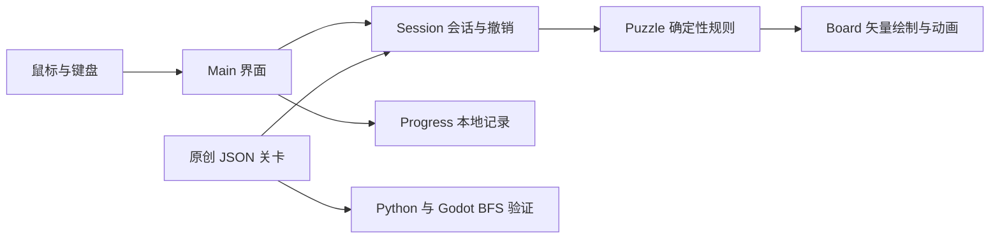

# GRAY 玩法分析与开发方案

GRAY 使用 Godot 4 和 GDScript，将 Neutronic 的核心规则重新实现为黑白网格解谜。第一版的重点是保证规则一致、操作流畅，并让每关的简单与困难目标有可靠区别。英文名暂用 GRAY，中文名暂用「灰」。

## 原项目使用的技术

本地 `neutron-garden` 的 README 将游戏命名为 **Neutronic**，Git 远程指向 `RayZh-hs/neutronic`。

| 部分 | 源码中使用的技术 | 对 GRAY 的意义 |
| --- | --- | --- |
| 前端 | Vue 3、JavaScript、Vite 6、Vue Router、Naive UI、Sass | 原版是网页应用；Godot 版本重新实现交互与绘制 |
| 后端 | Node.js、Express 4、better-sqlite3、SQLite | 服务账号、关卡和线上功能；单机首版不需要后端 |
| 关卡 | JSON，包含地板、传送门、棋子、目标步数、录像 | GRAY 使用自己的 JSON 格式和原创布局 |
| 规则 | `frontend/src/functions/useLevelGame.js` | 用于核对移动与传送门的判断顺序 |
| 状态查询 | `frontend/src/functions/useGameStateQueries.js` | 按坐标查询棋子、地板和成对传送门 |
| 界面 | DOM / CSS 动画，Vue 响应式状态 | 改为 Godot Control 与矢量绘制 |

原版还包含关卡编辑、专辑、录像回放、线上账号和公开关卡等功能。它已有 `goal` 目标步数与完成评级，但 GRAY 的困难模式要求用求解器验证全局最优值，不能仅把手工填写的目标当作最少步数。

## 核心规则必须保持的部分

1. 玩家选择任意一颗棋子，每次只向四邻格移动一格。
2. 目标格必须仍有地板。同色棋子阻挡，异色棋子合并消失。
3. 合并只移除碰撞发生处的地板，起点地板保留。
4. 棋盘上所有棋子消失后完成。黑白数量必须相等。
5. 走入空传送门，立刻传到同组另一端；一次传送行动只算一步，不递归传送。
6. 传送门出口同色阻挡，出口异色合并。入口已有异色时，优先在入口合并。
7. 传送门上合并后移除该端，另一端变为普通地板。

源码还有两个值得保留的边界：先检查出口是否被同色占据，再处理入口碰撞；相邻的两个传送门可能把棋子传回自己的起点，此时仍是一次合法行动。两种情况均已加入规则测试。

视觉上的「黑白合成灰」是合并瞬间的灰色过渡，随后棋子与目标地板消失。灰色棋子不会留在棋盘上，因为那会改变可通行空间和原有胜利条件。

## 简单和困难如何共用一关

两种模式共用完全相同的布局与移动规则，只改变完成判定。

- 简单：清空棋子即可，不设步数上限。
- 困难：清空棋子，且有效移动次数恰好等于该关全局最优值。

无效操作、切换选择不计步；一次传送算一步；撤销恢复到行动前的步数。困难超步不强制终止，允许探索完整解法；清空后显示还差多少目标，并开放重试、撤销和下一关。简单通关与困难通关分别记录。困难超步仍算完成一次简单目标，但不能获得困难标记。

为避免通过切模式绕过目标，切换模式会重开当前关卡。个人最佳跨模式共享，两个通关标记分别保存。

## Godot 架构

| 文件 | 责任 |
| --- | --- |
| `scripts/puzzle.gd` | 状态构造、合法移动、传送与合并、胜利判断、BFS |
| `scripts/session.gd` | 当前选择、有效步数、历史快照、模式与完成判定 |
| `scripts/board_view.gd` | 格子与棋子绘制、坐标命中、移动与消融动画 |
| `scripts/main.gd` | 关卡列表、模式切换、输入、完成面板与操作反馈 |
| `scripts/progress.gd` | 校验存档、简单／困难标记、个人最佳、临时文件写入后替换 |
| `data/levels.json` | 原创关卡、教学文案、最优步数、解法与搜索记录 |

状态用两个等长数组表示：地形数组保存缺失地板、普通地板和传送门组号；棋子数组保存黑、白或空。规则函数接收旧状态，返回新状态与动作事件，不修改输入。撤销保存完整状态快照，因此地板消失和传送门退化也能完整恢复。

动画只消费规则结果，不能在计时器结束时再次修改棋盘。移动播放期间阻止第二次移动；撤销、重开或切关可以立即取消动画，避免延迟回调覆盖新的状态。规则层不依赖帧率或碰撞物理，因此很适合搜索验证和之后的录像功能。

## 最少步数怎样确定

一步就是一条等权边。将完整地形和棋子位置一起作为状态，遍历所有棋子及四个方向，BFS 第一次找到空棋盘时得到全局最短解。同色棋子没有独立身份，状态表示自然合并了等价排列。

不能只记棋子位置：相同位置配上不同的剩余地板，后续可走路径可能完全不同。也不能只按棋子两两距离求和：地板会消失、传送门会退化，局部最短配对可能导致死局。

认证时保存最优步数、完整合法解和访问状态数。Python 独立实现作为交叉检查，Godot 规则层再重放保存的解并自行 BFS。搜索达到上限时只报告未认证，不会自动给该关启用困难目标。首版关卡规模较小，搜索只用于制作和测试，玩家操作时不执行 BFS。

## 视觉和关卡节奏

暖白纸面、深灰文字、黑白棋子，灰色用于过渡与辅助信息；传送门采用字母和双环，避免依赖额外颜色。每次选择后显示可走邻格，地板消失保留明确的空位反馈。界面提供鼠标、键盘和屏幕方向按钮，首版按桌面横屏设计，已验证 1280×820 和 960×680。

第一批 12 关覆盖相遇、不可逆地形、合并顺序、传送与传送门退化。前几关用于学习规则；后续关卡包含 8 步和 12 步的最优解。章节之间引入新机制时可以缩短解长，难度不只取决于步数。当前内容属于原型关卡，正式版还需通过试玩观察误操作、死局频率和最优解发现时间，再扩展数量与曲线。

## 后续开发顺序

1. 试玩当前原型，确认核心规则、黑白表现和模式区别。
2. 扩充到约 30 关，增加关卡版本号；布局变更时重新认证，避免旧通关记录对应新布局。
3. 加入音效、静音设置、选择与错误移动反馈，并加强窄屏和触摸交互。
4. 制作关卡编辑器、导入导出与录像；先保证单机流程，再考虑账号、云存档和公开关卡。
5. 确定正式名称、图标和发行平台，补齐安装包与发布流程。

名称备选可保留「GRAY／灰」「合灰」「Between／黑白之间」。目前 GRAY 最简洁，也与黑白相遇的视觉概念一致；尚未做商标或商店重名检索。
