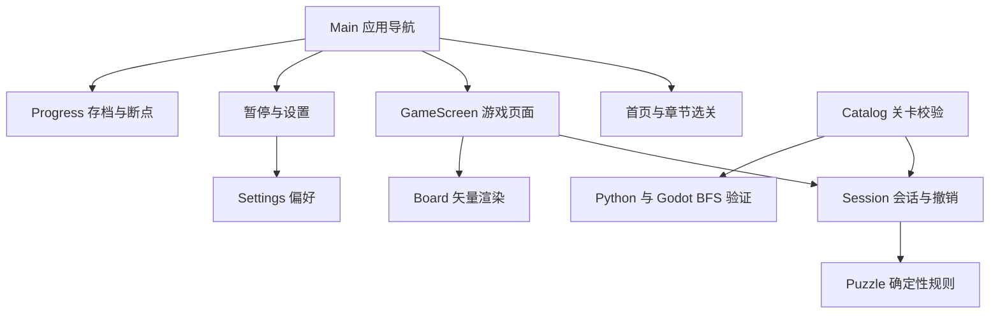

# NULL 玩法与实现方案

NULL（归零）是一款使用 Godot 4 和 GDScript 开发的黑白网格解谜游戏。当前版本围绕消融与空位建立极简视觉，并以 20 个关卡验证核心机制。设计重点是清晰的两种通关目标、可继续的单机对局，以及地形取舍的关卡节奏。

## 核心规则

1. 玩家选择任意一颗棋子，每次只向四邻格移动一格。
2. 目标格必须仍有地板。同色棋子阻挡，异色棋子合并消失。
3. 合并只移除碰撞发生处的地板，起点地板保留。
4. 棋盘上所有棋子消失后完成。黑白数量必须相等。
5. 走入空传送门，立刻传到同组另一端；一次传送行动只算一步，不递归传送。
6. 传送门出口同色阻挡，出口异色合并。入口已有异色时，优先在入口合并。
7. 传送门上合并后移除该端，另一端变为普通地板。

规则包含两个边界情况：先检查出口是否被同色占据，再处理入口碰撞；相邻的两个传送门可能把棋子传回自己的起点，此时仍是一次合法行动。两种情况均已加入规则测试。

视觉上的「黑白合成灰」是合并瞬间的灰色过渡，随后棋子与目标地板消失。灰色棋子不会留在棋盘上，以保持可通行空间和清空棋盘的胜利条件。

## 简单和困难如何共用一关

两种模式共用完全相同的布局与移动规则，只改变完成判定。

- 简单：清空棋子即可，不设步数上限。
- 困难：清空棋子，且有效移动次数恰好等于该关全局最优值。

无效操作、切换选择不计步；一次传送算一步；撤销恢复到行动前的步数。困难超步不强制终止，允许探索完整解法；清空后显示还差多少目标，并开放重试、撤销和下一关。简单通关与困难通关分别记录。困难超步仍算完成一次简单目标，但不能获得困难标记。

为避免通过切模式绕过目标，切换模式会重开当前关卡。个人最佳跨模式共享，两个通关标记分别保存。

## Godot 架构

| 文件 | 责任 |
| --- | --- |
| `scripts/puzzle.gd` | 状态构造、合法移动、传送与合并、胜利判断、BFS |
| `scripts/session.gd` | 当前选择、有效步数、历史快照、模式与完成判定 |
| `scripts/board_view.gd` | 格子与棋子绘制、坐标命中、移动与消融动画 |
| `scripts/main.gd` | 页面导航、共享服务、暂停菜单、继续游戏与全屏快捷键 |
| `scenes/*_screen.tscn` | 首页、章节选关、游戏和设置的独立场景入口 |
| `scripts/game_screen.gd` | 游戏输入、关卡列表、模式切换、完成面板与操作反馈 |
| `scripts/ui/` | 首页、选关和设置页面，以及共享字体、按钮与布局方法 |
| `scripts/catalog.gd` | 关卡格式、门组配对、保存解法的合法性校验与内容哈希 |
| `scripts/progress.gd` | 存档版本迁移、简单／困难标记、个人最佳、断点与原子替换 |
| `scripts/settings.gd` | 邻格提示、减少动态、全屏与上次使用模式的本地偏好 |
| `data/levels.json` | 原创关卡、教学文案、最优步数、解法与搜索记录 |

状态用两个等长数组表示：地形数组保存缺失地板、普通地板和传送门组号；棋子数组保存黑、白或空。规则函数接收旧状态，返回新状态与动作事件，不修改输入。撤销保存完整状态快照，因此地板消失和传送门退化也能完整恢复。

动画只消费规则结果，不能在计时器结束时再次修改棋盘。移动播放期间阻止第二次移动；撤销、重开或切关可以立即取消动画，避免延迟回调覆盖新的状态。规则层不依赖帧率或碰撞物理，因此很适合搜索验证和之后的录像功能。

## 页面流程和断点续玩

启动页只显示中空的零形标记、NULL 字标、一个开始按钮和角落的设置入口。点击开始或按 Enter 直接进入当前模式的首个未完成关卡；存在断点时继续原对局。开场不增加等待或先选章节的步骤。关卡选择可从游戏左上角或暂停菜单进入，保留章节切换、模式和进度；关卡名称与目标在悬停时显示。

暂停是应用层的输入隔离：当前动画可以立即收束到已经确定的结果，棋盘规则不继续执行，背景不接收移动或撤销。暂停中进入设置，返回后仍停留在暂停菜单。离开游戏页保留当前会话，返回首页后仍可继续。

每次有效移动、撤销、重开和切关都会保存断点。断点保存关卡 ID、内容哈希、模式和合法行动序列；恢复时重新执行规则层，生成棋盘及撤销历史。非法动作、已修改的关卡或损坏的断点会被拒绝，不会恢复半个错误棋盘。完成棋盘后清除断点，通关记录单独保留。

存档 v2 的哈希覆盖规则版本、初始地形、棋子和最优步数。标题和教学文案调整不会使进度失效；实际谜题变化会使旧记录失效。v1 的首批关卡使用固定的旧内容哈希迁移，避免把旧奖章套用到已变更的地图。

## 最少步数怎样确定

一步就是一条等权边。将完整地形和棋子位置一起作为状态，遍历所有棋子及四个方向，BFS 第一次找到空棋盘时得到全局最短解。同色棋子没有独立身份，状态表示自然合并了等价排列。

不能只记棋子位置：相同位置配上不同的剩余地板，后续可走路径可能完全不同。也不能只按棋子两两距离求和：地板会消失、传送门会退化，局部最短配对可能导致死局。

认证时保存最优步数、完整合法解和访问状态数。Python 独立实现作为交叉检查，Godot 规则层再重放保存的解并自行 BFS。搜索达到上限时只报告未认证，不会自动给该关启用困难目标。首版关卡规模较小，搜索只用于制作和测试，玩家操作时不执行 BFS。

## 视觉和关卡节奏

视觉围绕「归零后的虚无」展开：接近黑色的冷调夜空、稀疏星点、长曝光式星轨与大面积留白。星轨围绕偏离画面中心的椭圆缓慢移动，中央保持空净。偶尔有一颗流星在边缘掠过，不阻止玩家立即开始。标题上方的细线椭圆既是数字 0，也是空的轨道；悬停或聚焦开始按钮时，环形轻微展开。图标沿用同一零形。

背景采用简单渐变着色器和原生矢量绘制，不依赖贴图或外部素材。首页保留完整星轨，选关和设置降低亮度，游戏中进一步淡化，避免与棋子、传送门和可走提示争夺注意力。星轨漂移按每秒 30 次更新，窗口缩放时保持轨道比例。

首页去掉介绍、外链、统计与并列菜单；开始操作立即进入关卡，不播放阻塞式开场。常规说明通过前三关和设置页提供。整体强调使用中性灰白，传送门保留字母与灰蓝差异，帮助在黑白主题下区分门组。

游戏页让棋盘悬浮于暗场中，减少围框、英文装饰标题和重复状态提示。顶部保留有效步数、模式、撤销与重开，底部保留关卡引导和需要处理的反馈。减少动态效果会停用标记过渡、页面淡入和棋子动画，同时立即冻结星轨、关闭流星和背景明暗过渡，保留静态画面。

正式名称为「归零 / NULL」，对应黑白相抵、清空棋盘的目标。启动时会将已有进度与设置复制到新名称对应的数据目录；若新目录已有文件，则保留当前文件。迁移不改动原文件。

目前 6 章 20 关。前 12 关覆盖相遇、不可逆地形、合并顺序与传送；新增「留与失」「往复」八关，专门练习共享通路、借位与传送调度。第 18 关必须先让一端传送门消失，再利用退化后的另一端作为普通地板；第 20 关的出口初始被同色棋子占据，需要先让出出口。章节引入新机制时可以缩短解长，难度不只取决于步数。正式曲线仍需根据试玩中的死局频率和最优解发现时间调整。

## 后续开发顺序

1. 试玩当前 20 关，记录需要提示的位置、误操作和死局原因，调整关卡顺序。
2. 制作关卡编辑与导入导出工具；新关仍先认证再进入主线。
3. 基于现有行动序列增加录像回放与个人最优解回顾。
4. 添加音效和更清楚的错误移动反馈，完善触摸与窄屏布局。
5. 继续扩充关卡，再按需要接入账号、云存档与公开关卡。
