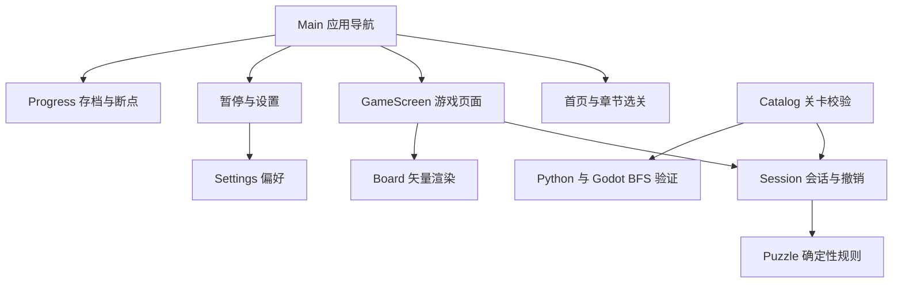

# ANNIHILATION 玩法与实现方案

ANNIHILATION（湮灭）是一款使用 Godot 4 和 GDScript 开发的黑白网格解谜游戏。当前版本围绕消融与空位建立极简视觉，并以 36 个关卡验证核心机制。设计重点是清晰的两种通关目标、可继续的单机对局，以及地形取舍的关卡节奏。

## 核心规则

1. 玩家选择任意一颗棋子，每次只向四邻格移动一格。
2. 目标格必须仍有地板。同色棋子阻挡，异色棋子合并消失。
3. 合并只移除碰撞发生处的地板，起点地板保留。
4. 棋盘上所有棋子消失后完成。黑白数量必须相等。
5. 走入空传送门，立刻传到同组另一端；一次传送行动只算一步，不递归传送。
6. 传送门出口同色阻挡，出口异色合并。入口已有异色时，优先在入口合并。
7. 传送门上合并后移除该端，另一端变为普通地板。
8. 单向场允许任意方向进入和停留，只能沿箭头方向离开，不会自动滑动。发生碰撞时只移除该格。

规则包含两个边界情况：先检查出口是否被同色占据，再处理入口碰撞；相邻的两个传送门可能把棋子传回自己的起点，此时仍是一次合法行动。两种情况均已加入规则测试。

视觉上的「黑白合成灰」是合并瞬间的灰色过渡，随后棋子与目标地板消失。灰色棋子不会留在棋盘上，以保持可通行空间和清空棋盘的胜利条件。

## 简单和困难如何共用一关

两种模式共用完全相同的布局与移动规则，只改变完成判定。

- 简单：清空棋子即可，不设步数上限。
- 困难：清空棋子，且有效移动次数恰好等于该关全局最优值。

无效操作、切换选择不计步；一次传送算一步；撤销恢复到行动前的步数。困难超步不强制终止，允许探索完整解法；清空后显示还差多少目标，并开放重试、撤销和下一关。简单通关与困难通关分别记录。困难超步仍算完成一次简单目标，但不能获得困难标记。

为避免通过切模式绕过目标，切换模式会重开当前关卡。个人最佳跨模式共享，两个通关标记分别保存。

## Godot 架构

| 文件 | 责任 |
| --- | --- |
| `scripts/puzzle.gd` | 状态构造、合法移动、传送与合并、胜利判断、BFS |
| `scripts/session.gd` | 当前选择、有效步数、历史快照、模式与完成判定 |
| `scripts/board_view.gd` | 格子与棋子绘制、坐标命中、移动与消融动画 |
| `scripts/main.gd` | 页面导航、共享服务、暂停菜单、继续游戏与全屏快捷键 |
| `scenes/*_screen.tscn` | 首页、章节选关、游戏和设置的独立场景入口 |
| `scripts/game_screen.gd` | 游戏输入、关卡列表、模式切换、完成面板与操作反馈 |
| `scripts/ui/` | 首页、选关和设置页面，以及共享字体、按钮与布局方法 |
| `scripts/catalog.gd` | 关卡格式、门组配对、保存解法的合法性校验与内容哈希 |
| `scripts/progress.gd` | 存档版本迁移、简单／困难标记、个人最佳、断点与原子替换 |
| `scripts/settings.gd` | 邻格提示、减少动态、全屏与上次使用模式的本地偏好 |
| `locale/*.po` | 英文与简体中文的界面、章节、关卡名称和说明翻译 |
| `data/levels.json` | 原创关卡、教学文案、最优步数、解法与搜索记录 |

状态用两个等长数组表示：地形数组保存缺失地板（-1）、普通地板（0）、传送门组号（1～26）和单向场方向（27～30）；棋子数组保存黑、白或空。规则函数接收旧状态，返回新状态与动作事件，不修改输入。撤销保存完整状态快照，因此地板消失和传送门退化也能完整恢复。

动画只消费规则结果，不能在计时器结束时再次修改棋盘。移动播放期间阻止第二次移动；撤销、重开或切关可以立即取消动画，避免延迟回调覆盖新的状态。规则层不依赖帧率或碰撞物理，因此很适合搜索验证和之后的录像功能。

## 页面流程和断点续玩

启动页显示中空的零形标记、Poppins Thin 字体的 ANNIHILATION 字标、开始按钮和角落的设置入口。零形缓慢旋转，银色亮光沿边缘流动；减少动态会冻结动画。点击开始或按 Enter 进入章节选关，有断点时可通过选关页的继续按钮恢复。首页不显示创作按钮。

主线按章节顺序解锁：第一章开放，本章全部关卡完成简单目标后开放下一章，已开放章节内可自由选关。困难通关同时计入简单通关，旧存档的困难标记也视为简单完成。未解锁章节可以浏览，但卡片不可点击；继续断点、应用导航和通关后的下一关同样检查解锁条件。

开发者模式开放所有主线章节，并允许关卡创作。关闭后恢复依据实际通关记录计算的访问范围，不补发或清除通关标记。若当前开发者对局位于尚未解锁章节，则返回选关，保留断点，待再次获得访问权限后继续。

暂停是应用层的输入隔离：当前动画可以立即收束到已经确定的结果，棋盘规则不继续执行，背景不接收移动或撤销。暂停中进入设置，返回后仍停留在暂停菜单。离开游戏页保留当前会话，返回首页后仍可继续。

每次有效移动、撤销、重开和切关都会保存断点。断点保存关卡 ID、内容哈希、模式和合法行动序列；恢复时重新执行规则层，生成棋盘及撤销历史。非法动作、已修改的关卡或损坏的断点会被拒绝，不会恢复半个错误棋盘。完成棋盘后清除断点，通关记录单独保留。

存档 v2 的哈希覆盖规则版本、初始地形、棋子和最优步数。标题和教学文案调整不会使进度失效；实际谜题变化会使旧记录失效。v1 的首批关卡使用固定的旧内容哈希迁移，避免把旧奖章套用到已变更的地图。

## 最少步数怎样确定

一步就是一条等权边。将完整地形和棋子位置一起作为状态，遍历所有棋子及四个方向，BFS 第一次找到空棋盘时得到全局最短解。同色棋子没有独立身份，状态表示自然合并了等价排列。

不能只记棋子位置：相同位置配上不同的剩余地板，后续可走路径可能完全不同。也不能只按棋子两两距离求和：地板会消失、传送门会退化，局部最短配对可能导致死局。

认证时保存最优步数、完整合法解和访问状态数。Python 独立实现作为交叉检查，Godot 规则层再重放保存的解并自行 BFS。搜索达到上限时只报告未认证，不会自动给该关启用困难目标。首版关卡规模较小，搜索只用于制作和测试，玩家操作时不执行 BFS。

## 视觉和关卡节奏

视觉围绕「相遇、湮灭后的虚无」展开：纯黑底色（#000000）、稀疏星点、长曝光式星轨与大面积留白。星轨围绕偏离画面中心的椭圆缓慢移动，中央保持空净。偶尔有一颗流星在边缘掠过，不阻止玩家立即开始。标题上方的细线椭圆既是数字 0，也是空的轨道；悬停或聚焦开始按钮时，环形轻微展开。图标沿用同一零形。

背景使用纯黑色块和原生矢量绘制，不添加灰蓝渐变或辉光。首页保留完整星轨，选关和设置降低亮度，游戏中进一步淡化，避免与棋子、传送门和可走提示争夺注意力。星轨漂移按每秒 30 次更新，窗口缩放时保持轨道比例。

首页仅保留标记、标题、开始和设置；开始进入选关，不播放阻塞式开场。操作与简短规则集中在「设置 → 操作」，游戏中不常驻教学文案。整体强调使用中性灰白，传送门按组使用固定的柔和配色：A 冰蓝、B 淡紫、C 青绿、D 浅金，后续组从分散的色相中取色。同组两端保持一致，边框、浅底和字母共用组色，并保留字母作为配对依据；一端合并后，退化为普通地板的另一端恢复普通格外观。

游戏页只保留关卡编号、有效步数、模式、撤销与重开；关卡名与章节仅通过编号的悬停提示显示。移除棋盘下方的关卡名、说明和超步劝导；无效操作只短暂显示「无法移动」，存档失败保留短提示，完成后只显示结果和步数。减少动态效果会停用标记过渡、页面淡入和棋子动画，同时立即冻结星轨、关闭流星和背景明暗过渡，保留静态画面。

布局直接响应窗口的实际尺寸，不对整个界面强制固定宽高比。棋盘在屏幕中央保持正方形格子，按关卡行列、可用空间和窗口短边选择格子大小；横向八格与五行方阵都完整显示。格子不使用固定像素上限，窗口增大时，棋盘、棋子、传送门字母、边线、步数、操作按钮和完成面板一同放大。工具栏和短暂反馈单独留出空间，窄屏时把模式切换移到第二行。布局检查覆盖 36 关 × 13 种窗口尺寸，包括 5K，并检查实际棋盘的比例增长、网格裁切、按钮重叠、指针命中、完成面板与缩放后的撤销。原生 F11 检查在正在进行的关卡中切换全屏，确认局面和历史不变。

首页按可用宽高的共同缩放比例，联动字标字号、字距、零形标记、开始按钮、间距和设置入口。标题使用 Poppins Thin 细字重，基准字号 64、字距 3；长字标保持单行，窄屏单独缩小标题，保留开始按钮的可读性和点击区域。普通桌面窗口保留基准大小；全屏与高分辨率窗口放大整组元素，避免固定像素字号相对画面缩小。开始按钮基准字号为 22，点击区域为 176 × 58；极窄窗口按空间收束。单独验证 320 × 480 至 5120 × 2880 的连续缩放、点击命中和恢复窗口，并检查原生 F11 全屏切换。

设置页的字体、边距、行距、语言下拉框、开关和返回按钮同样随窗口缩放，分别验证英文和中文的常规、操作两页，以及放大后恢复小窗口。界面采用实际字号重绘文字；通用 SVG 图标保留完整分辨率并使用 mipmap 缩小，开关使用 [DPITexture](https://docs.godotengine.org/en/4.6/classes/class_dpitexture.html) 从矢量源重新绘制到当前尺寸，避免把低分辨率开关图拉大。棋盘边框对齐像素，圆角与圆弧随显示尺寸增加细分，抗锯齿边缘保持一个像素宽，减少放大后的模糊和折线感。

选关页的章节标题、进度条、模式切换、关卡卡片、翻页和返回图标使用同一缩放基准；翻页箭头跟随实际卡片区域，避免宽屏时离内容太远。暂停菜单同步放大标题、按钮和面板留白，进入时聚焦继续按钮。容器在字体尺寸更新后重新贴合当前窗口，确保从大屏缩回时不会残留过大的最小尺寸。选关、设置和暂停共用尺寸记录与缩放方法，悬停提示的字号与留白也随页面增长。

外围页面检查覆盖 9 章 × 2 种语言 × 8 次窗口变化，包括 5K、超宽屏、竖屏和缩回普通窗口；检查实际鼠标点击卡片与翻页、暂停后进入设置并返回、回首页继续、重开和返回选关。设置页外层留白容器不接收鼠标，避免遮挡左上角返回入口。

正式名称为「湮灭 / ANNIHILATION」，对应黑白粒子相遇、粒子与碰撞处地板一同消融的核心玩法。首次启动会依次从 NULL、GRAY 旧目录复制已有进度、设置、编辑器草稿、自制关卡、本地排行榜和试玩记录；新目录已有文件优先保留，旧文件不改动。完成后写入迁移标记，避免之后删除的自制关卡在重启时重新出现。关卡和成绩 JSON 的格式标识保持兼容。

默认语言固定为英文，不随系统语言自动切换。「Settings → General → Language」提供 English / 简体中文选择，立即更新当前页面、隐藏页面、悬停提示和完成界面，并保存到本地偏好。缺失、损坏或不支持的语言偏好回退英文。语言切换只更新文字，不重建会话，也不修改关卡 ID、规则、存档哈希或撤销记录。

英文原文保存在界面代码和关卡元数据中，译文使用 Godot 原生 gettext PO 资源。共享界面处理翻译变更，动态的步数、继续按钮和关卡标题单独刷新；英文步数单位支持单复数。章节的内部键使用英文，显示时翻译，避免中文名称参与页面状态判断。

目前 11 章 36 关。第 01～20 关保留基础学习与熟悉机制的节奏；第 21～26 关为「暗流」「视差」两个进阶章节，依次练习逆向调度、主动后退、四对棋子的队列解缠、重复使用传送通路、三组门的路线切换与拥挤网络。新关最少步数为 13、14、24、19、16、27，难点集中在合并时机和空间调度。引入第三组门时允许解长稍短，避免把步数当作唯一难度指标。

制作期检查会限制一类行动，再穷尽搜索能否绕过关键构思。第 22 关的初始直接合并都会死局；第 24 关必须发生黑棋子的反向 B 门传送；第 25、26 关的 A、B、C 三组门都不可省略。第 25 关允许简单模式绕过退化后的 B 门普通格，但会多走至少两步；第 26 关则必须使用这段地板。检查只约束声明的必要性质，保留不同合法解，不改变游戏规则。完整最少步数仍由 Python 与 Godot 独立 BFS 认证。

## 开发者模式与自制关卡

「设置 → 开发者」可开启开发者模式，随后进入关卡编辑器；开启后「我的关卡」也显示创作与编辑按钮。编辑器按需加载，支持 1～12 格宽高、地板与空洞、黑白棋子、A～Z 门组、拖动画图、整笔撤销与重做。草稿自动保存；主线地图以新身份复制，已保存的自制地图通过明确保存更新，离开未保存修改时保留草稿副本。

试玩复用独立的 GameScreen、会话和自制进度文件，不覆盖主线对局。自制地图不搜索理论最少步数；合法通关按实际走法计分，各名称保留最佳成绩，形成当前已知纪录的本地榜。保存后的地图出现在选关页的「我的关卡」，普通模式仍可游玩和查看排行榜。

导入导出使用版本化 JSON，支持本地文件及复制粘贴，Web 可选择上传文件并下载导出。导出包含关卡和成绩走法；导入时按游戏规则重放成绩，只合并有效完成且更优的个人纪录。开发者模式关闭时隐藏创作与编辑入口，保留草稿和已保存关卡。

第 31～36 关引入「矢量」「红移」两章：先学习单向转弯与断环，再比较顺流最短路和更长绕行，最后组合不能离开的汇流点、传送门与多棋子的交通调度。单向格恢复普通地板边框，正中绘制大号低透明度单箭头，放在棋子下层；编辑器的方向选择器使用相同的矢量图形并保留较高对比度。独立的「单向场」工具可展开四个大按钮，切换其他画笔后记住方向。「地图设置」收起来源与尺寸控件，试玩和保存操作固定在工具区底部。棋子覆盖地板时方向标记仍然可见；悬停可查看单格规则，不添加常驻说明。

第 27～30 关属于「星群」，在保留原有 26 关的基础上，使用 4～6 组传送阵和 8～12 颗棋子。七行大图在较小窗口中收紧棋盘留白，维持完整网格、工具栏间距与可点击格子的尺寸。

## 后续开发顺序

1. 试玩当前 36 关，记录需要提示的位置、误操作和死局原因，调整关卡顺序。
2. 继续用编辑器制作关卡；新关先认证，再筛选进入主线。
3. 基于现有行动序列增加录像回放与个人最优解回顾。
4. 添加音效和更清楚的错误移动反馈，完善触摸与窄屏布局。
5. 继续扩充关卡，再按需要接入账号、云存档与公开关卡。
